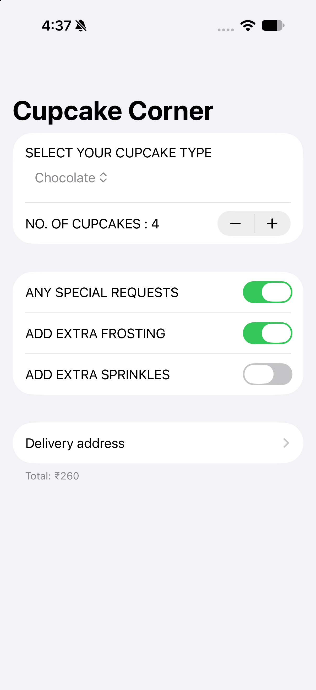
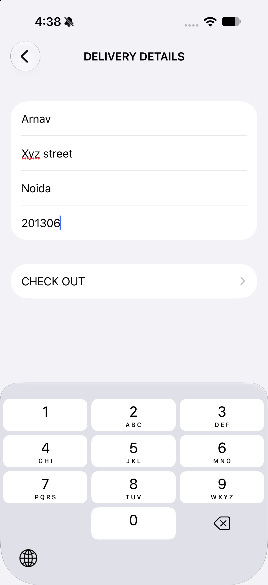
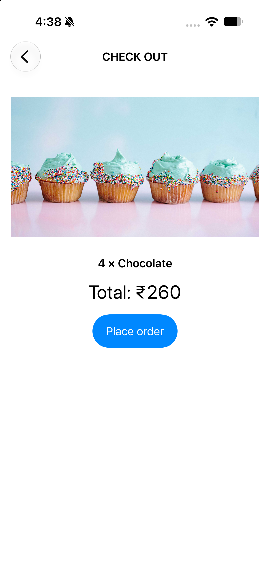

# Cupcake Corner

A small iOS app for ordering cupcakes, built with SwiftUI. Choose a flavor and quantity, add optional extras, enter a delivery address, and place the order over the network.

The project started from the Cupcake Corner tutorial by Hacking with Swift and was then extended and adapted (prices in INR, UI and flow changes).

## Screenshots

<!-- Add screenshots to a /Screenshots folder and update the paths below. -->

| Order | Delivery details | Check out | Confirmation |
|-------|------------------|-----------|--------------|
|  |  |  |  |

## Features

- Pick from five flavors: vanilla, butterscotch, strawberry, rainbow and chocolate
- Choose between 1 and 20 cupcakes
- Optional special requests: extra frosting and extra sprinkles (turning special requests off clears both)
- Running total shown on the first screen as options change
- Delivery form that must be fully filled in before checkout is enabled
- Order summary and total on the checkout screen
- Order sent as JSON with `async/await` and `URLSession`, with a confirmation alert on success
- Prices shown in Indian rupees (INR)

## Pricing

| Item | Price |
|------|-------|
| Base price per cupcake | ₹50 |
| Flavor surcharge | ₹5 per step in the flavor list (vanilla ₹0, butterscotch ₹5, strawberry ₹10, rainbow ₹15, chocolate ₹20) per cupcake |
| Extra frosting | ₹10 per cupcake |
| Extra sprinkles | ₹5 per cupcake |

Example: 4 chocolate cupcakes with extra frosting = 4 × 50 + 4 × 20 + 4 × 10 = ₹320.

> Note: the flavor surcharge is currently applied once per order (`Decimal(type) * 5`), not per cupcake. Adjust `Order.cost` if you want it per cupcake.

## Tech stack

- **Swift** and **SwiftUI**
- **Observation** framework (`@Observable`, `@Bindable`) for shared order state
- **Codable** with custom `CodingKeys` so an `@Observable` class can be encoded and decoded
- **NavigationStack** for the three-screen flow
- **URLSession** with `async/await` for the network request
- **AsyncImage** for the checkout banner

## Requirements

- Xcode 15 or later
- iOS 17 or later (required by `@Observable`)

## Getting started

1. Clone the repository:
   ```bash
   git clone https://github.com/<your-username>/cupcakeOrder.git
   ```
2. Open `cupcakeOrder.xcodeproj` in Xcode.
3. Select an iPhone simulator (or a connected device).
4. Press **Run** (⌘R).

An internet connection is needed for the checkout image and for placing the order.

## Project structure

```
cupcakeOrder/
├── cupcakeOrderApp.swift   App entry point
├── ContentView.swift       Flavor, quantity and special requests
├── AddressView.swift       Delivery details form
├── CheckoutView.swift      Summary, total and order submission
├── Order.swift             Observable, Codable order model and pricing
└── Assets.xcassets         App icon and colors
```

## How ordering works

1. `ContentView` edits a shared `Order` object.
2. `AddressView` collects name, street, city and PIN code. `hasValidAddress` enables the checkout link only when every field is filled in.
3. `CheckoutView` encodes the order to JSON and sends a `POST` request. The response is decoded back into an `Order` and used to build the confirmation message.

The order is posted to a public test endpoint, so no real order is created. The server simply echoes the data back.

## Roadmap

- [ ] Disable the order button and show a progress indicator while a request is running
- [ ] Return to a fresh order after a successful checkout
- [ ] Show an error alert when the request fails
- [ ] Validate PIN codes as exactly six digits
- [ ] Trim whitespace when validating address fields
- [ ] Save the last delivery address
- [ ] Replace the flavor index with an `enum`
- [ ] Order history with SwiftData
- [ ] Unit tests for pricing and validation

## Credits

- Based on the Cupcake Corner project from [100 Days of SwiftUI](https://www.hackingwithswift.com/100/swiftui) by Paul Hudson
- Cupcake image from the Hacking with Swift site

## Author

Arnav Singh
